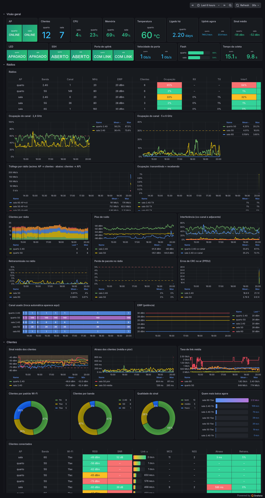
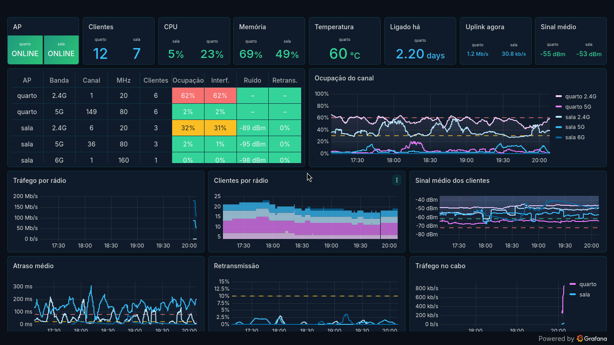

# huawei-ap-grafana

Monitorar access points Huawei (AP3xx / AP6xx / AP7xx / AirEngine em modo autônomo, o "Fat AP") com Prometheus e Grafana, sem SNMP e sem controladora: um script entra no AP por SSH, lê os comandos `display`, transforma em métricas e o Grafana desenha.



Versão compacta, feita para caber numa tela 1366×768 em modo kiosk:



## Como funciona

```
 AP Huawei ──SSH──▶ huawei_ap_exporter.py ──▶ huawei-ap.prom ──▶ node_exporter ──▶ Prometheus ──▶ Grafana
             (a cada 30 s, timer systemd)     (textfile collector)
```

1. O **timer do systemd** roda `huawei_ap_exporter.py` a cada 30 segundos.
2. O script abre uma sessão SSH interativa em cada AP (eles não aceitam `ssh ap comando`, só shell interativo), roda uma lista fixa de comandos `display` e lê a saída.
3. A saída é convertida em métricas no formato texto do Prometheus e gravada de forma atômica em `/var/lib/prometheus/node-exporter/huawei-ap.prom`.
4. O **textfile collector do node_exporter** publica esse arquivo junto com as métricas normais da máquina. O Prometheus não precisa de job novo.
5. O **Grafana** usa o dashboard deste repositório.

Os APs Huawei têm dois CLIs diferentes, e o script fala os dois:

| `cli` | Modelos (exemplos) | Como os dados chegam |
|---|---|---|
| `vrp` | AP361, AP362, AP661, AirEngine 5760… | texto em tabela: `display radio all`, `display station all`, `display vap all`, `display health`, `display version`, `display interface <porta>` |
| `mdcli` | AP673, AP773, AirEngine Wi-Fi 7… | JSON: `display wifi-radio/wifi-radio-statistics/`, `display wifi-sta/wifi-sta-statistics/`, `display cpu-memory all`, `display ifm/interfaces/interface[name="<porta>"]/mib-statistics/` |

Se o AP mostra o prompt `<Huawei>` ao entrar por SSH, é `vrp`. Se mostra `MDCLI>` ou responde em JSON, é `mdcli`.

## O que dá pra extrair

| Grupo | Métricas |
|---|---|
| AP | `huawei_ap_up`, `huawei_ap_cpu_percent`, `huawei_ap_memory_percent`, `huawei_ap_temperature_celsius{sensor}`, `huawei_ap_uptime_seconds`, `huawei_ap_info{version}`, `huawei_ap_storage_percent{partition}`, `huawei_ap_led_on`, `huawei_ap_ssh_up`, `huawei_ap_scrape_seconds`, `huawei_ap_collect_timestamp_seconds` |
| Cabo (uplink) | `huawei_ap_uplink_up`, `huawei_ap_uplink_speed_mbps`, `huawei_ap_uplink_receive_bytes_total`, `huawei_ap_uplink_transmit_bytes_total`, `huawei_ap_uplink_receive_errors_total`, `huawei_ap_uplink_transmit_errors_total`, `huawei_ap_uplink_crc_errors_total` |
| Rádio (por banda) | `huawei_radio_channel`, `huawei_radio_bandwidth_mhz`, `huawei_radio_power_dbm`, `huawei_radio_max_power_dbm`, `huawei_radio_clients`, `huawei_radio_utilization_percent`, `huawei_radio_rx_utilization_percent`, `huawei_radio_tx_utilization_percent`, `huawei_radio_interference_percent`, `huawei_radio_adjacent_interference_percent`, `huawei_radio_noise_dbm`, `huawei_radio_retrans_percent`, `huawei_radio_packet_loss_percent`, `huawei_radio_up_bps`, `huawei_radio_down_bps`, `huawei_radio_crc_error_ppdu`, `huawei_radio_spatial_streams` |
| Cliente (por estação) | `huawei_sta_rssi_dbm`, `huawei_sta_snr_db`, `huawei_sta_link_mbps`, `huawei_sta_mcs`, `huawei_sta_spatial_streams`, `huawei_sta_delay_ms`, `huawei_sta_max_delay_ms`, `huawei_sta_retrans_percent`, `huawei_sta_packet_loss_percent`, `huawei_sta_up_kbps`, `huawei_sta_down_kbps`, `huawei_sta_online_seconds`, `huawei_sta_rx_mbps`, `huawei_sta_tx_mbps` |
| SSID | `huawei_vap_up`, `huawei_vap_clients` |

Todas têm os rótulos `ap`, `model`, `site` e `ip`. Rádios ganham `band` (2.4G / 5G / 6G), clientes ganham `band`, `ssid`, `mac`, `phy`, `sta_ip` e `hostname`. Nem todo modelo entrega todos os campos: o que o AP não informa simplesmente não vira métrica.

## Instalação

Precisa de uma máquina Linux na mesma rede dos APs, com `python3` (só biblioteca padrão), `openssh-client` e o `node_exporter` com textfile collector ligado.

```bash
# 1. script
sudo install -m 755 huawei_ap_exporter.py /usr/local/bin/huawei_ap_exporter.py

# 2. configuração e senha (a senha fica num arquivo separado, legível só pelo root)
sudo install -d -m 750 /etc/huawei-ap
sudo install -m 640 config.example.json /etc/huawei-ap/config.json
sudo nano /etc/huawei-ap/config.json
sudo sh -c 'umask 077; read -rs -p "Senha SSH dos APs: " p; echo; printf "%s" "$p" > /etc/huawei-ap/password'

# 3. teste: imprime as métricas na tela sem gravar arquivo
sudo HUAWEI_AP_CONFIG=/etc/huawei-ap/config.json HUAWEI_AP_PASS_FILE=/etc/huawei-ap/password \
     python3 /usr/local/bin/huawei_ap_exporter.py --stdout | grep huawei_ap_up

# 4. timer
sudo cp systemd/huawei-ap-exporter.* /etc/systemd/system/
sudo systemctl daemon-reload
sudo systemctl enable --now huawei-ap-exporter.timer
```

O `node_exporter` precisa ler o diretório do arquivo `.prom`. No Debian/Ubuntu o pacote `prometheus-node-exporter` já usa `/var/lib/prometheus/node-exporter`. Em outras instalações, adicione `--collector.textfile.directory=/var/lib/prometheus/node-exporter` (ou mude `HUAWEI_AP_PROM_FILE` na unit).

### Configuração

```json
{
  "user": "admin",
  "aps": [
    {"name": "ap-sala",   "host": "192.0.2.10", "model": "AP673", "site": "sala",   "cli": "mdcli", "uplink": "MultiGE0/0/0"},
    {"name": "ap-quarto", "host": "192.0.2.11", "model": "AP361", "site": "quarto", "cli": "vrp",   "uplink": "GigabitEthernet0/0/0"}
  ]
}
```

- `name`, `model` e `site` são livres e só viram rótulos. O dashboard agrupa as cores e legendas por `site`.
- `uplink` é a porta cabeada do AP (veja com `display interface brief`). Se omitir, usa `GigabitEthernet0/0/0` no `vrp` e `MultiGE0/0/0` no `mdcli`.
- Variáveis de ambiente aceitas: `HUAWEI_AP_CONFIG`, `HUAWEI_AP_PASS_FILE`, `HUAWEI_AP_PROM_FILE`, `HUAWEI_AP_KNOWN_HOSTS`.

## Dashboard no Grafana

Importe `grafana/dashboard.json` (completo) ou `grafana/dashboard-tv.json` (compacto) em **Dashboards → New → Import** e escolha o datasource Prometheus quando ele pedir.

Os JSONs são gerados por `grafana/make_dashboard.py`, que dá pra rodar de novo para personalizar:

```bash
python3 grafana/make_dashboard.py > dashboard.json                       # completo, pede o datasource ao importar
python3 grafana/make_dashboard.py --layout tv > dashboard-tv.json        # compacto para TV / kiosk
python3 grafana/make_dashboard.py --datasource <uid> --uid wifi --title "Wi-Fi"   # amarrado a um datasource
python3 grafana/make_dashboard.py --colors cores.json --header topo.md    # cores fixas e texto no topo
python3 grafana/make_dashboard.py --mask                                  # esconde nome, IP, MAC e SSID dos clientes
```

`--colors` recebe um JSON com cores por `"site banda"` ou por `site`, por exemplo `{"sala 5G": "#38BDF8", "quarto": "#E879F9"}`. `--mask` serve para tirar print sem expor a rede.

O dashboard completo tem quatro seções:

- **Visão geral**: AP online, clientes, CPU, memória, temperatura, tempo ligado, tráfego no cabo, sinal médio, LED, SSH, porta e flash.
- **Rádios**: tabela de rádios (canal, largura, EIRP, ocupação, interferência, ruído, retransmissão), ocupação do canal por banda, tráfego por rádio, transmitindo × recebendo, clientes, ruído, interferência co-canal e adjacente, retransmissão, perda, erros de CRC, histórico de canal e potência.
- **Clientes**: sinal, atraso médio e pior, taxa de link, padrão Wi-Fi, banda, qualidade do sinal, quem mais baixa e a tabela de clientes conectados.
- **Uplink e hardware**: tráfego e erros do cabo, temperatura, CPU/memória e quanto tempo cada coleta leva.

## Dicas e limites

- Cada coleta leva de 10 a 25 segundos (o SSH dos APs é lento). Com dois APs, 30 segundos de intervalo é o mínimo confortável; acompanhe `huawei_ap_scrape_seconds`.
- Os APs aceitam poucas sessões SSH simultâneas. Se você também entra manualmente, pode dar `huawei_ap_up 0` numa coleta isolada.
- Use uma conta só de leitura no AP se o modelo permitir. O script só roda comandos `display` e `screen-length`.
- A senha nunca vai para o `.prom` nem para o log: a saída dos comandos passa por um filtro que troca a senha por `***`.
- A chave do AP é aceita na primeira conexão e guardada em `/var/lib/huawei-ap/known_hosts`. Se trocar o AP, apague a linha dele.

## Licença

MIT
